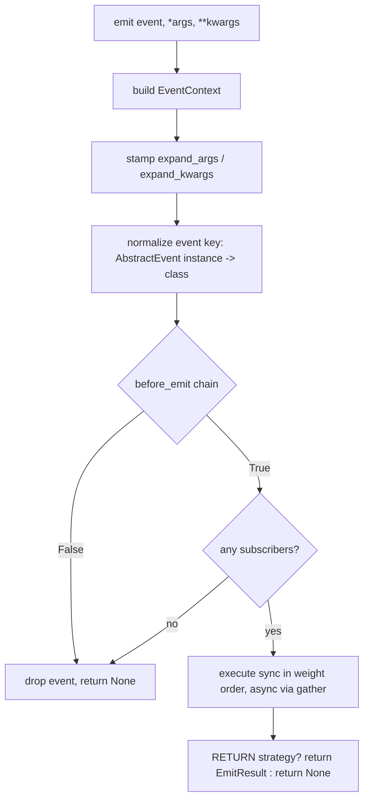

# Architecture

This document describes the internal design of `async-event-bus`: the package
layout, the modular composition model, the event emission pipeline, the
executor, and the exception / concurrency model.

## Package Layout

```
src/async_event_bus/
├── __init__.py                 # public API re-exports
├── event_bus.py                # EventBus — the full-featured composite bus
├── event/
│   ├── __init__.py
│   ├── event.py                # EnumEvent, AbstractEvent, EventType, EventInstance, EventContext
│   └── event_callback.py       # EventCallback (+ Sync/Async), EventCallbackContainer
└── module/
    ├── __init__.py
    ├── base_module.py          # BaseModule, EmitResult, the executor (_execute_callback)
    ├── core_module.py          # CoreModule — subscriptions and emit
    ├── filter_module.py        # FilterModule — propagation gating
    ├── inject_module.py        # InjectModule — context mutation
    └── module_exceptions.py    # ExceptionStrategy, MultipleError
```

## Design Overview

The library is built from a few composable building blocks:

- **Unified event keys** — plain strings, `EnumEvent` members and
  `AbstractEvent` classes are all indexed by one type alias (`EventType`), so
  a single registry dictionary covers every event kind.
- **`EventContext` as the single carrier** — one object flows through the
  whole pipeline; subscribers, filters and injectors all receive it, and it
  also carries the per-emit unpacking flags.
- **Callback wrappers with metadata** — `EventCallback` and its sync/async
  subclasses attach scheduling metadata (sync vs async, weight) to raw
  callables; containers keep them deduplicated and weight-sorted.
- **Modules as mixins** — each concern (subscribe/emit, injection, filtering)
  is a separate class; the full `EventBus` is their MRO combination.
- **A cooperative `before_emit` chain** — injectors and filters hook into the
  emission before subscribers run and can abort it.
- **One executor** — `_execute_callback` runs every kind of callback with
  consistent ordering, concurrency and exception semantics.

## Core Concepts

### Event keys

```python
EventType = EnumEvent | type[AbstractEvent] | str  # registry / subscription key
EventInstance = EnumEvent | AbstractEvent | str  # accepted by emit()
```

`emit()` accepts instances, while the registry is keyed by types:

- `str` keys are used as-is.
- `EnumEvent` members are hashable and used directly.
- `AbstractEvent` **instances** are normalized to their class:
  `bus.emit(LifeCycleEvent(True, True))` subscribes under `LifeCycleEvent`,
  and the instance is available to handlers as `ctx.event`.

### EventContext

`EventContext[E]` is a generic dataclass: `event`, `timestamp`, `args`,
`kwargs`, plus two non-constructor scheduling flags `expand_args` and
`expand_kwargs` set by `emit()`. Subclass it to attach domain data and pass the
subclass as `context_class`:

```python
bus = EventBus(context_class=AppContext)  # instantiates AppContext on every emit
```

### Callback wrappers

`EventCallback.create()` inspects the callable (`inspect.iscoroutinefunction`)
and returns `SyncEventCallback` or `AsyncEventCallback`. Wrappers expose
`.weight` (mutable at runtime) and `.is_async`, and compare equal by
*callback identity + weight*, so re-registering the same function with a
different weight creates a distinct entry.

### CallbackContainer

`EventCallbackContainer` keeps two ordered lists per event:

- `_sync_callback` — sequential execution, sorted by weight (descending).
- `_async_callback` — concurrent execution; weight is irrelevant at runtime.

`add_callback()` deduplicates and re-sorts eagerly at registration time, so
emission never pays the sorting cost. Removal accepts either the wrapper or the
original function.

## Module Architecture (MRO Composition)

```python
class EventBus(CoreModule[C, R], InjectModule[C], FilterModule[C]):
    ...
```

The MRO linearizes to:

```
EventBus → CoreModule → InjectModule → FilterModule → BaseModule
```

| Module         | Responsibility                              | Note                                |
|----------------|---------------------------------------------|-------------------------------------|
| `BaseModule`   | semaphore, exception strategy, executor     | abstract base                       |
| `CoreModule`   | subscription registry, `emit` / `emit_sync` | parameterized `BaseModule[C, R]`    |
| `InjectModule` | global + per-event injectors                | parameterized `BaseModule[C, None]` |
| `FilterModule` | global + per-event filters                  | parameterized `BaseModule[C, bool]` |

The three modules parameterize the base with different `R` — `R`, `None`,
`bool` — yet the MRO still linearizes cleanly because each class only extends
`BaseModule` and overrides orthogonal methods.

### The cooperative `before_emit` chain

`before_emit` is a cooperative chain: each module does its part and delegates
to `super()`. Because of the MRO, the order is:

```
CoreModule.before_emit        # pass-through
  → InjectModule.before_emit  # run injectors; abort (return False) on failure
    → FilterModule.before_emit  # global filters → per-event filters; abort on False
      → BaseModule.before_emit  # terminal node, returns True
```

This is how the modules participate without owning the pipeline: a custom
module inserted into the MRO (see below) can run its own logic at any point of
the chain.

## Event Emission Pipeline



Step by step:

1. `ctx = self._context_class(event=event, args=list(args), kwargs=kwargs)`
2. `ctx.expand_args` / `ctx.expand_kwargs` are stamped so the whole
   `before_emit` chain (injectors, filters) can honor unpacking without a
   signature change.
3. `AbstractEvent` instances are normalized to their class as the registry key.
4. The `before_emit` chain runs; `False` aborts the emission.
5. Subscribers are looked up; no subscribers → the event is a no-op.
6. Subscribers run through `_execute_callback`.
7. Under `ExceptionStrategy.RETURN` the `EmitResult` is returned; otherwise
   `None`.

`emit_sync` is a blocking wrapper that handles three event-loop scenarios:
running loop (`run_coroutine_threadsafe`), non-running loop
(`loop.run_until_complete`), and no loop (create + tear down a temporary one).

## The Executor (`_execute_callback`)

`_execute_callback(container, ctx, handler=None, ...)` is the single execution
engine used by subscribers, filters and injectors alike.

Execution order:

1. **Sync callbacks** run sequentially in descending weight order — their
   side effects are deterministic.
2. **Async callbacks** run concurrently via `asyncio.gather`; each is wrapped
   in `_run_with_semaphore` so at most `max_concurrent_tasks` coroutines are
   active at once. Weight is meaningless among them.
3. **`handler` predicate** (used by filters): if any result fails the
   predicate, execution stops. For sync callbacks this short-circuits before
   async scheduling; for async callbacks all results are checked afterwards.

Exceptions are dispatched by the active `ExceptionStrategy` (see below), and
the method returns an `EmitResult` with `results` (successful outcomes) and
`exceptions` kept separate.

## Exception Model

`ExceptionStrategy` is chosen at construction and switchable at runtime via
the `exception_strategy` property:

| Strategy            | Behaviour                                                                     |
|---------------------|-------------------------------------------------------------------------------|
| `IGNORE`            | log and continue; nothing raised, `emit` returns `None`                       |
| `RAISE`             | fail fast; first exception re-raised immediately, remaining callbacks aborted |
| `COLLECT` (default) | all callbacks run; exceptions raised together as `MultipleError`              |
| `RETURN`            | never raise; outcomes returned as `EmitResult`                                |

- `MultipleError` wraps every collected exception (`e.exceptions`).
- `EmitResult` is a generic dataclass with `results: list[R]` and
  `exceptions: list[Exception]`.

Filters and injectors run under the same strategy as subscribers; with
`COLLECT`, injector failures bubble up through `InjectModule.before_emit`,
which catches them and drops the event to protect subscribers from incomplete
contexts.

## Concurrency Model

- A single `asyncio.Semaphore(max_concurrent_tasks)` bounds concurrent async
  callbacks (default 10 on `EventBus`).
- Async callbacks are collected with `asyncio.gather(return_exceptions=True)`
  so one failure never cancels its siblings (except in `RAISE` mode, where
  `return_exceptions=False` aborts everything on the first failure).
- Only *async* callbacks consume semaphore slots; sync callbacks run inline.

## Extending the Bus

### Custom bus — inherit `CoreModule`

Override `before_emit` to add cross-cutting logic or reject events:

```python
class CustomEventBus(CoreModule):
    async def before_emit(self, event: EventType, ctx: EventContext) -> bool:
        if event == MessageEvent.MESSAGE_DELETE:
            return False
        ctx.kwargs["timestamp"] = time.time()
        return await super().before_emit(event, ctx)
```

### Custom module — inherit `BaseModule`

Insert a module anywhere in the chain via MRO composition:

```python
class CustomModule(BaseModule[EventContext, bool]):
    async def before_emit(self, event: EventType, ctx: EventContext) -> bool:
        ...  # your logic
        return await super().before_emit(event, ctx)


class CustomEventBus(CoreModule, CustomModule):
    pass
```

`clear()` is the uniform reset hook: modules override it to drop their
registries (used for hot reloading / resetting the bus).
