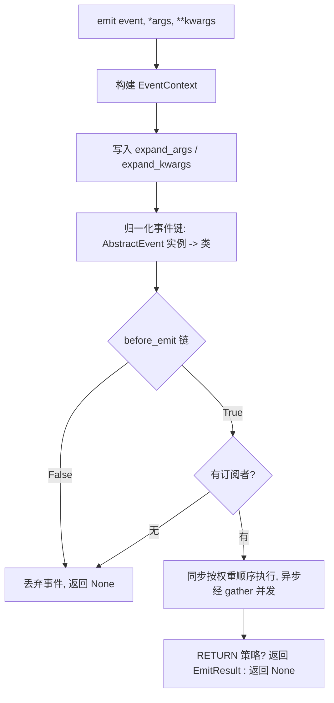

# 架构文档

本文档介绍 `async-event-bus` 的内部设计：包结构、模块组合模型、事件发布流水线、
执行器，以及异常与并发模型。

## 包结构

```
src/async_event_bus/
├── __init__.py                 # 公共 API 再导出
├── event_bus.py                # EventBus — 功能完整的总线组合体
├── event/
│   ├── __init__.py
│   ├── event.py                # EnumEvent, AbstractEvent, EventType, EventInstance, EventContext
│   └── event_callback.py       # EventCallback（+ Sync/Async）、EventCallbackContainer
└── module/
    ├── __init__.py
    ├── base_module.py          # BaseModule、EmitResult、执行器（_execute_callback）
    ├── core_module.py          # CoreModule — 订阅与发布
    ├── filter_module.py        # FilterModule — 传播拦截
    ├── inject_module.py        # InjectModule — 上下文预处理
    └── module_exceptions.py    # ExceptionStrategy、MultipleError
```

## 设计总览

库由一组可组合的积木构成：

- **统一的事件键** — 普通字符串、`EnumEvent` 枚举成员、`AbstractEvent` 类统一用
  一个类型别名（`EventType`）索引，一个注册表字典即可覆盖所有事件类型。
- **`EventContext` 作为唯一载体** — 一个对象贯穿整个流水线，订阅者、过滤器、
  注入器都接收它；它还携带本次 emit 的参数展开标志。
- **带元数据的回调包装器** — `EventCallback` 及其同步/异步子类把调度元数据
  （同步/异步、权重）附着在原始函数上；容器负责去重并按权重排序。
- **模块即混入（mixin）** — 每个关注点（订阅/发布、注入、过滤）是一个独立类；
  完整的 `EventBus` 是它们的 MRO 组合。
- **协作式 `before_emit` 链** — 注入器和过滤器在订阅者执行前介入发布流程，
  并可终止它。
- **单一执行器** — `_execute_callback` 以一致的顺序、并发和异常语义执行所有
  类型的回调。

## 核心概念

### 事件键

```python
EventType = EnumEvent | type[AbstractEvent] | str  # 注册表/订阅键
EventInstance = EnumEvent | AbstractEvent | str  # emit() 的入参
```

`emit()` 接收实例，注册表以类型为键：

- `str` 键原样使用。
- `EnumEvent` 成员可哈希，直接作为键。
- `AbstractEvent` **实例**归一化为其类：`bus.emit(LifeCycleEvent(True, True))`
  以 `LifeCycleEvent` 为订阅键，实例通过 `ctx.event` 供处理器访问。

### EventContext

`EventContext[E]` 是泛型 dataclass：`event`、`timestamp`、`args`、`kwargs`，
外加两个由 `emit()` 写入、不参与构造的调度标志 `expand_args` 和
`expand_kwargs`。可继承以附加业务字段，并把子类作为 `context_class` 传入：

```python
bus = EventBus(context_class=AppContext)  # 每次 emit 实例化 AppContext
```

### 回调包装器

`EventCallback.create()` 通过 `inspect.iscoroutinefunction` 判断并返回
`SyncEventCallback` 或 `AsyncEventCallback`。包装器暴露 `.weight`
（运行时可改）和 `.is_async`，相等性基于 *回调身份 + 权重*——同一函数以不同
权重重复注册会生成独立条目。

### 回调容器

`EventCallbackContainer` 为每个事件维护两个有序列表：

- `_sync_callback` — 顺序执行，按权重降序排序。
- `_async_callback` — 并发执行；权重在运行时无意义。

`add_callback()` 在注册时即去重并排序（急切排序），发布时不再付出排序开销。
移除时既接受包装器也接受原始函数。

## 模块架构（MRO 组合）

```python
class EventBus(CoreModule[C, R], InjectModule[C], FilterModule[C]):
    ...
```

MRO 线性化为：

```
EventBus → CoreModule → InjectModule → FilterModule → BaseModule
```

| 模块             | 职责                         | 说明                         |
|----------------|----------------------------|----------------------------|
| `BaseModule`   | 信号量、异常策略、执行器               | 抽象基类                       |
| `CoreModule`   | 订阅注册表、`emit` / `emit_sync` | 参数化为 `BaseModule[C, R]`    |
| `InjectModule` | 全局 + 事件级注入器                | 参数化为 `BaseModule[C, None]` |
| `FilterModule` | 全局 + 事件级过滤器                | 参数化为 `BaseModule[C, bool]` |

三个模块以不同的 `R`（`R`、`None`、`bool`）参数化基类，但 MRO 依然能干净
线性化——因为每个类只继承 `BaseModule` 且覆盖的是互不重叠的方法。

### 协作式 before_emit 链

`before_emit` 是协作链：每个模块完成自己的部分后委托给 `super()`。借助 MRO，
执行顺序为：

```
CoreModule.before_emit         # 透传
  → InjectModule.before_emit   # 执行注入器；失败则中止（返回 False）
    → FilterModule.before_emit # 全局过滤器 → 事件过滤器；返回 False 则中止
      → BaseModule.before_emit # 终端节点，返回 True
```

模块正是以此方式参与而无需占有整条流水线：把自定义模块插入 MRO（见下文），
即可在链的任意位置执行自己的逻辑。

## 事件发布流水线



逐步说明：

1. `ctx = self._context_class(event=event, args=list(args), kwargs=kwargs)`
2. 写入 `ctx.expand_args` / `ctx.expand_kwargs`，使整条 `before_emit` 链
   （注入器、过滤器）无需改签名即可感知参数展开。
3. `AbstractEvent` 实例归一化为其类作为注册表键。
4. 执行 `before_emit` 链；返回 `False` 则终止发布。
5. 查找订阅者；没有订阅者则事件为无操作。
6. 订阅者经 `_execute_callback` 执行。
7. 处于 `ExceptionStrategy.RETURN` 时返回 `EmitResult`，否则返回 `None`。

`emit_sync` 是阻塞包装器，处理三种事件循环场景：循环运行中
（`run_coroutine_threadsafe`）、循环存在但未运行（`loop.run_until_complete`）、
无循环（创建临时循环后销毁）。

## 执行器（_execute_callback）

`_execute_callback(container, ctx, handler=None, ...)` 是订阅者、过滤器、注入器
共用的唯一执行引擎。

执行顺序：

1. **同步回调**按权重降序依次执行——副作用确定。
2. **异步回调**通过 `asyncio.gather` 并发执行；每个都包在
   `_run_with_semaphore` 里，保证同时最多 `max_concurrent_tasks` 个协程活跃。
   异步回调之间的权重无意义。
3. **`handler` 谓词**（过滤器使用）：任一结果不满足谓词即停止执行。同步回调
   在调度异步前短路；异步回调执行完后再统一检查结果。

异常按当前 `ExceptionStrategy` 分流（见下），方法返回 `EmitResult`，其中
`results`（成功结果）与 `exceptions` 分开存放。

## 异常模型

`ExceptionStrategy` 在构造时选择，可通过 `exception_strategy` 属性运行时切换：

| 策略            | 行为                               |
|---------------|----------------------------------|
| `IGNORE`      | 记录日志后继续；不抛任何异常，`emit` 返回 `None`  |
| `RAISE`       | 快速失败；第一个异常立即抛出，中止剩余回调            |
| `COLLECT`（默认） | 所有回调执行完，异常统一以 `MultipleError` 抛出 |
| `RETURN`      | 永不抛出；结果以 `EmitResult` 返回         |

- `MultipleError` 包装所有收集到的异常（`e.exceptions`）。
- `EmitResult` 是泛型 dataclass，含 `results: list[R]` 与
  `exceptions: list[Exception]`。

过滤器与注入器与订阅者共用同一策略；`COLLECT` 模式下注入器异常会向上冒泡到
`InjectModule.before_emit`，被其捕获后丢弃事件，防止订阅者拿到不完整的上下文。

## 并发模型

- 单个 `asyncio.Semaphore(max_concurrent_tasks)` 限制异步回调的并发数
  （`EventBus` 默认 10）。
- 异步回调用 `asyncio.gather(return_exceptions=True)` 收集，单个失败不会
  取消其它回调（`RAISE` 模式除外——那里 `return_exceptions=False`，
  第一个失败即中止一切）。
- 只有 *异步* 回调占用信号量额度；同步回调内联执行。

## 扩展总线

### 自定义总线 —— 继承 CoreModule

覆写 `before_emit` 加入横切逻辑或拒绝事件：

```python
class CustomEventBus(CoreModule):
    async def before_emit(self, event: EventType, ctx: EventContext) -> bool:
        if event == MessageEvent.MESSAGE_DELETE:
            return False
        ctx.kwargs["timestamp"] = time.time()
        return await super().before_emit(event, ctx)
```

### 自定义模块 —— 继承 BaseModule

通过 MRO 组合把模块插入链中任意位置：

```python
class CustomModule(BaseModule[EventContext, bool]):
    async def before_emit(self, event: EventType, ctx: EventContext) -> bool:
        ...  # 你的逻辑
        return await super().before_emit(event, ctx)


class CustomEventBus(CoreModule, CustomModule):
    pass
```

`clear()` 是统一的复位钩子：模块覆写它以清空自己的注册表（用于热重载 /
重置总线）。
